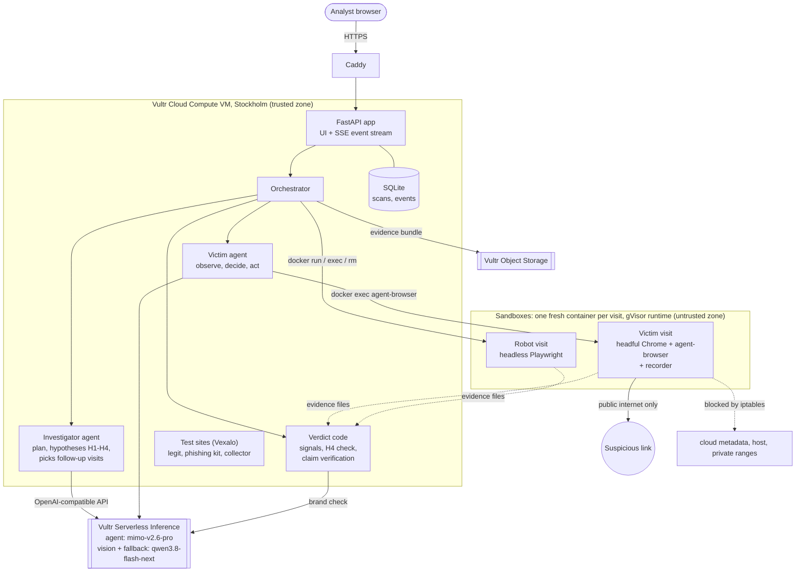
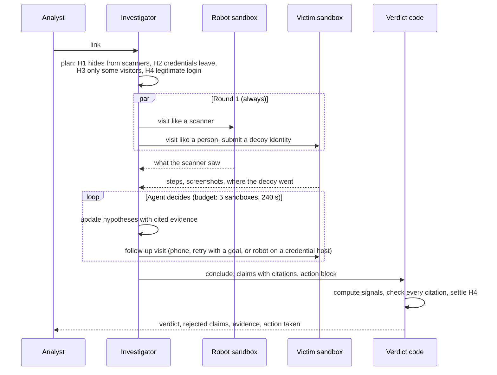

# Architecture

Phish Detonator investigates a suspicious link the way a security analyst would, but inside disposable sandboxes. An investigator agent plans the case, sends a scanner-like robot and a person-like victim to the link in separate gVisor sandboxes, decides which follow-up visits to run, and concludes with claims that code checks against the evidence. On phishing, the agent blocks the link itself; an analyst can override.

## System

## One investigation

## How the agent owns the case

| Step | Agent | Code |
|---|---|---|
| Plan | Writes the plan, may add a hypothesis H5 | Fixes H1 to H4 so every case tests the same questions |
| Explore | Chooses the next visit from a fixed menu with a first-person reason | Validates the tool and its arguments, enforces the sandbox and time budget |
| Victim visit | Picks every click and field from the page snapshot | Allows only refs from the latest snapshot and only decoy placeholders as text; the approval gate checks every submit |
| Conclude | Writes claims with citations, proposes block or none | Rejects any claim whose citation does not show the claimed signal; the verdict comes from signals code computed |
| Argue against itself | | Refutes or supports H4 "this is a legitimate login" by checking each credential destination: same site, brand-owned, known login provider |
| Act | Blocks the link on phishing | Allows the block only when H4 is refuted |

## Verdict rules

Phishing needs a combination: the decoy password reached a third party (S1) and the page also lied, by showing a brand its host does not own (S4), showing scanners different content (S2), or handing the victim to the real brand after taking the password (M4). A password to a third party alone is Suspicious. Bot-detection probes (S3) are shown as context only, because legitimate bot protection reads the same properties. The output is never "safe": the weakest result is "No evidence found".

## Containment

| Organizer focus | Control |
|---|---|
| Process isolation | Every visit runs in a new container under gVisor (`--runtime=runsc`): read-only root, all capabilities dropped, no new privileges, non-root user. Chrome and agent-browser never run on the host; the browser's debugging port is never published. |
| Secret hygiene | No API key enters a container. The model only sees and writes the placeholders `{{DECOY_EMAIL}}` and `{{DECOY_PASSWORD}}`; the host fills in a per-scan decoy identity. |
| Resource limits | 2 GB memory, 2 CPUs, 512 processes and 120 s wall clock per visit; 5 sandboxes and 240 s per investigation; global caps and a per-IP rate limit on the public URL. |
| Lifecycle | One container per visit, removed in a `finally` block; a backstop timer ends any container a crashed app leaves behind. |
| Network | iptables rejects private, link-local, cloud metadata and host addresses from the sandbox network; blocked attempts are logged and shown on screen. |
| Verifiable output | Every claim cites an evidence file line; code verifies each citation; the evidence bundle is hashed and signed. |
| Untrusted content | Page text reaches the model only inside `<untrusted_page>` tags; model output is validated JSON and never reaches a shell. |

## Vultr products

| Product | Job |
|---|---|
| Cloud Compute (Stockholm) | Hosts the app, Docker with gVisor, the sandboxes and the test sites |
| Serverless Inference | Every model call: investigator, victim agent, vision brand check. Models chosen by a 40-call structured-output benchmark: `mimo-v2.6-pro` (10/10 correct, no repairs), `qwen3.8-flash-next` as vision model and fallback |
| Object Storage | Evidence bundles with presigned links |
| Firewall Group | Inbound 22 (team), 80 and 443 only |

## Measured reliability (laptop runs, real Vultr model)

| Case | Result |
|---|---|
| Phishing kit | 3 of 3 Phishing, blocked by the agent |
| Mobile-only kit | 3 of 3 Phishing: the investigator read the phone-only notice and dispatched a phone visit on its own |
| Legit Vexalo login (with bot protection) | No evidence found, H4 supported |

## Known limits

- Datacenter IP, software WebGL renderer and a desktop Chrome engine under a mobile user agent can be detected by deep fingerprinting and commercial bot walls.
- Test sites use the invented brand Vexalo; the system never imitates a real company.
